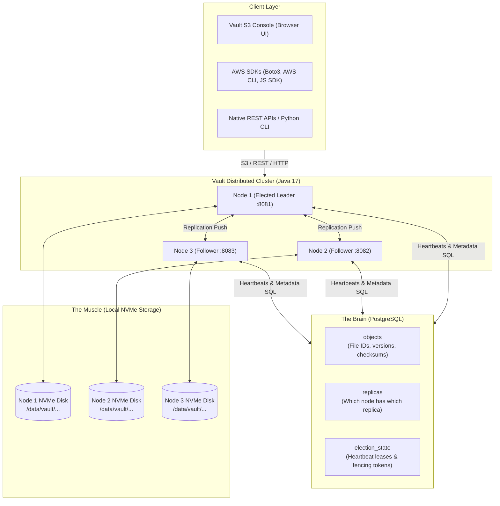

# Vault 🛡️
> **The Postgres-Native, S3-Compatible Distributed Object Storage Engine**
>
> **Keywords:** durability · quorum · replication · self-healing

[](https://github.com/Jayanand07/Vault/actions/workflows/ci.yml)
[](https://openjdk.org/)
[](https://spring.io/projects/spring-boot)
[](https://www.postgresql.org/)
[-FF9900?style=flat&logo=amazons3&logoColor=white)](docs/API_REFERENCE.md)
[](LICENSE)

---

## 💡 What is Vault?

Modern applications that store files (images, PDFs, machine learning models) usually face two bad options:
1. **Storing in PostgreSQL as `bytea` / BLOBs**: Causes massive database bloat, slow checkpoints, and memory crashes.
2. **Storing in AWS S3 or Google Cloud**: Isolates file metadata in proprietary clouds, making relational SQL `JOIN`s impossible and incurring punishing cloud egress bills.

**Vault solves this by decoupling metadata from binary storage:**
* 🧠 **The Brain (PostgreSQL)**: Manages metadata, versions, SHA-256 checksums, durability tiers, replica placements, and lease-based leader elections with atomic row locks.
* 💪 **The Muscle (Local Disks)**: Heavy binary payloads stream in bounded 8 KB chunks to local disk storage across cluster nodes with SHA-256 pre-verification on reads.
* 🔌 **The Interface (REST + Experimental S3 + Web Console)**: Interact via the native REST API (`/api/v1/objects`), the experimental `/s3/{bucket}/{key}` path adapter (using `X-API-Key`), the **Web Management Console**, or the zero-dependency **Python CLI**.

```sql
-- Join user accounts with their physical files using standard SQL!
SELECT users.username, objects.object_id, objects.size_bytes, objects.checksum_sha256
FROM users
JOIN objects ON users.avatar_id = objects.object_id
WHERE objects.status = 'ACTIVE';
```

---

## 🏗️ Architecture



---

## ✨ Key Features

1. **Experimental S3 Adapter (`/s3/{bucket}/{key}`) & Native REST (`/api/v1/objects`)**: Supports multi-segment slash keys (`reports/q3.pdf` via unencoded path or `?key=reports/q3.pdf`). Note `/s3` uses `X-API-Key` auth and does not implement AWS SigV4 or multipart uploads.
2. **Tunable Durability Quorums (Early-Quorum Ack)**: Choose safety vs. speed dynamically via `X-Vault-Durability`:
   - `CRITICAL` ($N=5, W=3, R=2$): Strict quorum (skips `DEGRADED` nodes; requires $\ge 5$ non-degraded nodes for full $N=5$ redundancy — a 3-node cluster with all 3 nodes healthy meets $W=3$ with degraded `3/5` placement, and fewer than 3 non-degraded nodes fails fast with `507`).
   - `STANDARD` ($N=3, W=2, R=1$): Early-quorum durability for application files (Default — returns once $W$ acks arrive without blocking on stragglers).
   - `TEMPORARY` ($N=1, W=1, R=1$): Maximum speed for ephemeral caches & video transcodes.
3. **Pre-Verified Reads & Peer Fallback Self-Healing**: Local and internal reads validate full-file SHA-256 and expected size on the pinned `FileChannel` **before** committing HTTP `200 OK` (corrupt bytes are never served). Missing or corrupt local replicas fall back transparently to healthy peers streamed via temp staging (`Flux<DataBuffer>`) before serving and triggering background repair.
4. **Collision-Free Disk Storage & Bounded Uploads**: Objects are keyed on disk via `objects/<h0..2>/<h2..4>/<sha256(key)>.v<version>.dat` (`ObjectKey`, with `fsync` before atomic rename — recreate dev volumes if upgrading from an older version). Raw binary `PUT` bodies are bounded by `vault.storage.max-object-size-bytes` (128 MiB default; HTTP `413`), and multipart form bodies are rejected with `415`.
5. **Interactive Web Console & Object Health Inspector**: Manage files via the console (`website/console.html` / `/console.html`), inspect replica placements, and copy REST examples.
6. **PostgreSQL-Coordinated Leader Lease & Fencing**: Uses PostgreSQL atomic row locks with 5-second leases and monotonic election terms.

---

## 🚀 Quick Start (60 Seconds)

### Option A: 3-Node Cluster (Docker Compose)
```bash
# 1. Configure secrets before starting (no default secrets outside dev profile)
cp secrets/db_password.txt.example secrets/db_password.txt
cp .env.example .env
# Edit secrets/db_password.txt and .env with strong random values (openssl rand -hex 32)
# See docs/SECRETS_REMEDIATION.md for credential rotation and hygiene guidance.

# 2. Start 3 Vault nodes + PostgreSQL (bound to 127.0.0.1:5432) + Prometheus + Grafana
docker compose up -d --build

# 3. Open the Web Management Console in your browser
# URL: http://localhost:8081/console.html
```

### Option B: Local Standalone Node (Explicit `dev` Profile Only, No Docker Required)
> **Warning:** `ProductionSafetyCheck` refuses to start Vault with missing or exposed default credentials (`changeme`, `vault_secret`, `vault-dev-key`, `test-key`) unless `SPRING_PROFILES_ACTIVE=dev` is explicitly activated for local-only development.

```powershell
# Windows PowerShell (activates dev profile automatically)
.\scripts\run-local.ps1 -Mode single
```
```bash
# Linux / macOS
./scripts/run-local.sh single
```

---

## 💻 4 Ways to Interact with Vault

### 1. Web Management Console
Open `http://localhost:8080/console.html` (or `website/console.html`).
* **Live Cluster Telemetry**: Monitor active nodes, leader state, and term counters.
* **Drag-and-Drop S3 Explorer**: Upload files, select durability tiers, and preview images/PDFs.
* **🔬 Object Health Inspector**: Inspect SHA-256 hashes, physical replica locations, and bit-rot status.
* **Code Generator**: Instant copyable AWS CLI, Boto3, and cURL snippets.

### 2. Python CLI (`scripts/vault_cli.py`)
```bash
# Check cluster status
python scripts/vault_cli.py cluster

# Upload file with STANDARD quorum
python scripts/vault_cli.py put ./document.pdf --tier STANDARD

# Inspect health, replicas, and SHA-256 integrity
python scripts/vault_cli.py inspect document.pdf

# List stored objects
python scripts/vault_cli.py list

# Download file
python scripts/vault_cli.py get document.pdf -o ./downloaded.pdf
```

### 3. Experimental S3-Style Adapter (`/s3/{bucket}/{key}`)
`/s3/{bucket}/{key}` maps path-style S3 PUT/GET/DELETE calls onto Vault's core pipeline. Authentication requires the `X-API-Key` header (AWS Signature V4 and multipart uploads are **not** implemented):
```bash
export VAULT_API_KEY="<your-vault-api-key>"

# Raw S3-path PUT / GET (or use scripts/verify_s3_boto3.py which injects X-API-Key for Boto3)
curl -X PUT -L "http://localhost:8081/s3/finance/report.pdf" \
  -H "X-API-Key: $VAULT_API_KEY" \
  -H "Content-Type: application/octet-stream" \
  --data-binary @report.pdf

curl -L "http://localhost:8081/s3/finance/report.pdf" \
  -H "X-API-Key: $VAULT_API_KEY" -o download.pdf
```

### 4. Native REST API (cURL)
```bash
export VAULT_API_KEY="<your-vault-api-key>"

# Upload raw binary payload (slash keys supported via ?key=... or unencoded path)
curl -X PUT -L "http://localhost:8081/api/v1/objects?key=reports/my-file.txt" \
  -H "X-API-Key: $VAULT_API_KEY" \
  -H "X-Vault-Durability: STANDARD" \
  -H "Content-Type: application/octet-stream" \
  --data-binary @my-file.txt

# Download
curl -H "X-API-Key: $VAULT_API_KEY" "http://localhost:8081/api/v1/objects?key=reports/my-file.txt" -o my-file.txt
```

---

## 🧪 Testing, Benchmarks & Chaos Engineering

| Tool | Command | Description |
| :--- | :--- | :--- |
| **Maven Unit & Integration** | `mvn -B test` | Runs unit/MVC/H2 regression suites plus `VaultPostgresIntegrationTest` and `PostgresSchemaMigrationIntegrationTest` (real Postgres 15 + Flyway `V1..V7`, mandatory in CI via `-Dvault.postgres-it.required=true`). |
| **3-Node Compose Smoke** | `bash scripts/smoke_compose.sh` | Boots 3 Vault nodes + PostgreSQL 15 via Docker Compose and verifies PUT, idempotency replay, GET, `/inspect`, container disk bit-rot fallback, and DELETE -> 404. |
| **Benchmark Suite** | `python scripts/benchmark.py -c 4 -n 100 -s 64` | Measures throughput (ops/sec, MB/s) and latency percentiles (p50, p95, p99). |
| **Chaos Harness** | `python scripts/chaos_test.py` | Injects 1-bit corruption on disk and asserts transparent read-repair. |
| **S3 Adapter Verifier**| `python scripts/verify_s3_boto3.py` | Validates `/s3/{bucket}/{key}` PUT/GET/DELETE with `X-API-Key` (and Boto3 header hook). |
| **Disaster Recovery** | `python scripts/vault_dr_audit.py` | Scans disk directories, audits integrity against PostgreSQL, and identifies orphans. |

---

## 📊 Observability (Prometheus & Grafana)

Vault exports real-time Micrometer metrics into Prometheus and Grafana:
* **Grafana Dashboard**: `http://localhost:3000` (Password configured via `GF_SECURITY_ADMIN_PASSWORD` in `.env`)
* **Prometheus Targets**: `http://localhost:9090`
* **Metrics Tracked**: Read/Write throughput, replication failures, PostgreSQL-coordinated leader lease events, and JVM heap utilization.
* **Health Endpoint Details**: `/actuator/health` restricts detailed topology fields via `management.endpoint.health.show-details=when_authorized` outside the `dev` profile.

---

## 🗂️ Repository Structure

```text
vault/
├── .github/workflows/ci.yml    # Automated build, unit/Testcontainers suites & Compose smoke test
├── vault-common/               # Shared domain models, exceptions, checksum & ObjectKey utilities
├── vault-node/                 # Spring Boot storage node (REST, /s3 adapter, Flyway, PostgreSQL lease)
├── docs/                       # Architecture, protocol, API, benchmarks & security runbooks
├── grafana/                    # Pre-provisioned Grafana datasources & Vault dashboard
├── scripts/                    # Smoke test, chaos, benchmark, DR audit & Python CLI tooling
├── secrets/                    # Secret templates (real runtime secrets gitignored)
├── website/                    # Static landing page, docs & Web Management Console assets
├── docker-compose.yml          # 3-node cluster + PostgreSQL 15 + Prometheus + Grafana stack
├── Dockerfile                  # Multi-stage Java 17 image build
└── prometheus.yml              # Scrape configuration for cluster node telemetry
```

---

## 📚 Complete Documentation Suite

| Document | Description |
| :--- | :--- |
| [**VAULT_EXPLAINER.md**](docs/VAULT_EXPLAINER.md) | High-level conceptual guide: What Vault does, how it works, and request lifecycles. |
| [**ARCHITECTURE.md**](docs/ARCHITECTURE.md) | System components, consensus mechanics, consistent hash ring, and memory profile. |
| [**FAILURE_RECOVERY.md**](docs/FAILURE_RECOVERY.md) | Deep dive into all 6 failure modes (node crashes, SPOF analysis, bit-rot, and network partitions). |
| [**REPLICATION_PROTOCOL.md**](docs/REPLICATION_PROTOCOL.md) | Quorum math ($N, W, R$), the 6-stage write pipeline, and soft-delete tombstone protocols. |
| [**API_REFERENCE.md**](docs/API_REFERENCE.md) | Full S3 compatibility matrix (supported vs. planned) and native REST endpoints. |
| [**BENCHMARKS.md**](docs/BENCHMARKS.md) | Empirical throughput/latency analysis and comparison against MinIO and PostgreSQL `bytea`. |
| [**DEMO_SCRIPT.md**](docs/DEMO_SCRIPT.md) | 5-minute capstone presentation walkthrough and viva defense cheat sheet (top 5 tough questions). |
| [**SECRETS_REMEDIATION.md**](docs/SECRETS_REMEDIATION.md) | Secret rotation, credential hygiene, and Git history cleanup procedure. |

---

## 📄 License
Vault is distributed under the [MIT License](LICENSE).
