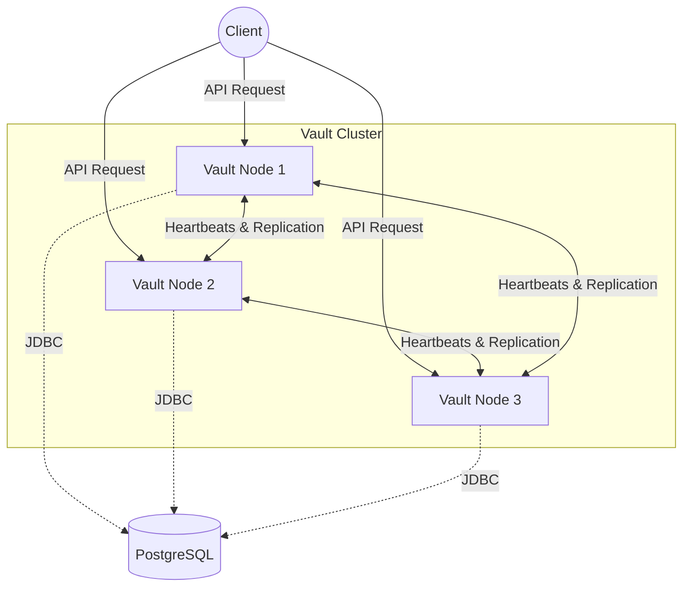

# Vault 🛡️

> A Highly Available, Fault-Tolerant Distributed Object Storage System

Vault is a production-grade distributed object storage cluster built in Java (Spring Boot) and backed by PostgreSQL. It implements core distributed systems concepts such as **Consistent Hashing**, **Leader Election**, **Quorum Reads/Writes**, and **Merkle Tree Anti-Entropy** to guarantee data availability and consistency even when nodes crash or the network partitions.

---

## 🏗️ Architecture

At a high level, Vault acts as a ring of cooperating nodes. Clients can talk to *any* node, and the node will route requests to the cluster leader or the correct replica owners.



### Core Concepts

1. **Consistent Hashing:** Objects are mapped to a 360-degree virtual ring. When a node joins or leaves, only a fraction of the data needs to move, preventing mass rebalancing.
2. **Leader Election:** The cluster elects a leader using a lease-based heartbeat mechanism via PostgreSQL. Only the leader initiates replication.
3. **Quorum (N, W, R):** Uses Tunable Consistency. A write must be acknowledged by `W` nodes to succeed. A read must be verified by `R` nodes. 
4. **Adaptive Consistency:** Reads automatically scale between `EVENTUAL` and `STRONG` consistency depending on the user-requested Durability Tier (`CRITICAL`, `STANDARD`, `TEMPORARY`).
5. **Anti-Entropy (Read Repair & Scrubber):** If a corrupted file is detected during a read, it repairs itself transparently. A background scrubber validates files passively. The cluster also auto-recovers replication lag after a node rejoins.

---

## 🚀 Quick Start

### Prerequisites
- [Docker](https://docs.docker.com/get-docker/) & Docker Compose
- Java 17+ (Java 21 recommended for virtual threads support, if running manually)

### 1. Boot the Cluster
Vault ships with a complete Docker Compose environment (3 Nodes + 1 Postgres + Prometheus + Grafana).
```bash
# Start the cluster in detached mode
docker-compose up -d

# Check cluster health
docker-compose ps
```

### 2. Verify Cluster Status
Check the status of the hash ring and node registry:
```bash
curl http://localhost:8081/api/v1/cluster/status
```

### 3. Write an Object
Store a file with `STANDARD` durability (3 replicas, wait for 2 acks).
```bash
curl -X PUT -H "Content-Type: application/octet-stream" \
     -H "X-Vault-Durability: STANDARD" \
     --data-binary "@my-file.txt" \
     http://localhost:8081/api/v1/objects/my-file.txt
```

### 4. Read an Object
```bash
curl -O http://localhost:8081/api/v1/objects/my-file.txt
```

---

## 📊 Observability (Prometheus & Grafana)

Vault exposes deep metrics into its internal operations.
- **Grafana Dashboard**: `http://localhost:3000` (User: `admin` / Password: `admin`)
- **Prometheus**: `http://localhost:9090`

You can monitor `vault_writes_total`, JVM Heap Usage, and Cluster Elections in real-time.

---

## 🧪 Testing and Simulation

Vault includes scripts to test resilience and performance.

### Simulate Node Failure
Run the provided failure script to watch the cluster handle a node crash and gracefully recover:
```bash
./scripts/simulate-failure.sh
```

### Load Testing
A `k6` load test is included to benchmark quorum-write throughput.
```bash
# Install k6: https://k6.io/docs/get-started/installation/
k6 run scripts/load-test.js
```

---

## 🔒 Security

- **API Keys**: Endpoints are protected via the `X-API-Key` header.
- **Rate Limiting**: Built-in Caffeine token bucket limits excessive traffic per IP.
- **Docker Secrets**: Database credentials are not baked into the images; they are securely injected at runtime via `/run/secrets`.

---

## 🛠️ API Reference

| Endpoint | Method | Description |
|----------|--------|-------------|
| `/api/v1/objects/{id}` | `PUT` | Write an object. Headers: `X-Vault-Durability`, `X-Idempotency-Key` |
| `/api/v1/objects/{id}` | `GET` | Read an object (performs read-repair if needed) |
| `/api/v1/objects/{id}` | `HEAD` | Get metadata (size, checksum, version) |
| `/api/v1/objects` | `GET` | Paginated list of objects in the cluster |
| `/api/v1/objects/{id}` | `DELETE` | Tombstone an object (garbage collected later) |
| `/api/v1/cluster/status` | `GET` | View ring topology and node health |
| `/api/v1/cluster/leader` | `GET` | View current leader ID and term |

---

*Developed as a capstone project for production-grade distributed system engineering.*
