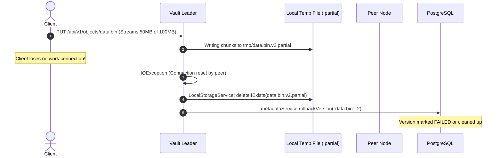

# Vault: Failure Modes & Recovery Protocols

> **"In distributed systems, failure scenarios matter far more than the happy path."**  
> This document specifies Vault's behavioral guarantees, invariant protection, and recovery protocols across the 6 major failure conditions.

---

## 1. Overview of Failure Resiliency Invariants

Vault enforces three core distributed invariants:

1. **No Phantom Commits**: An object version is NEVER marked `ACTIVE` in PostgreSQL unless the configured write quorum ($W$) has successfully acknowledged and persisted the payload to disk.
2. **Immutable Versioning**: File payloads on disk are named with their immutable version (`<object_id>.v<version>.dat`). In-flight writes occur on isolated `.partial` temporary files, preventing partially-written files from corrupting previous versions.
3. **Fail-Closed on Split Brain**: Write coordination requires valid PostgreSQL leader leases with monotonically increasing election terms (fencing tokens). Stale leaders are rejected before committing metadata.

---

## 2. Detailed Failure Scenarios & Recovery Matrix

| Scenario | Immediate System Reaction | Recovery Mechanism | Data Loss Risk |
| :--- | :--- | :--- | :---: |
| **A. Node crashes during an upload** | In-flight HTTP stream terminates; write quorum fails if threshold not met | Temporary `.partial` files cleaned up on node restart; PostgreSQL metadata rolled back to `FAILED` | **Zero** |
| **B. A replica node becomes unavailable** | After `suspect-threshold` (3) missed heartbeats node becomes `SUSPECT`; after `down-threshold` (6) it becomes `DOWN` and is immediately evicted from `ConsistentHashRing`. Early quorum proceeds in ms if remaining nodes meet $W$ | Leader probes `DOWN` peers for recovery (`markNodeUp`); rate-limited, deduplicated rebalance/repair restores missing copies once node returns | **Zero** (within tier durability) |
| **C. PostgreSQL restarts or goes offline** | Nodes reject new writes with HTTP 503/409; in-flight transactions abort; disk data remains untouched | Automatic reconnection pool with exponential backoff; nodes re-verify leader leases | **Zero** (Temporary availability outage) |
| **D. Disk corruption / bit-rot occurs** | Pre-read `FileChannel` SHA-256 check detects mismatch **before** HTTP `200` is returned or during background scrub | Node refuses corrupt local bytes, streams verified replica from peer via staged temp file to user, and triggers background Read Repair (`staging -> verify -> atomic install`) | **Zero** (as long as 1 healthy replica meets quorum) |
| **E. Leader node loses its lease** | Current lease expires in PostgreSQL after 5s; node state transitions from `LEADER` to `FOLLOWER` | Followers trigger randomized election timer (7s–12s); first to acquire row lock becomes new Leader | **Zero** |
| **F. Network drops halfway through replication** | Remote HTTP replication call times out (`vault.replication.timeout-ms`, default 5s); connection aborted | Early-quorum exits immediately if $W$ met or remaining peers cannot reach $W$; else rolls back to `FAILED` and returns HTTP `507` | **Zero** |

---

## 3. Deep-Dive: Step-by-Step Scenario Walkthroughs

### Scenario A: Leader or Client Crashes During an Upload



*   **Temporary File Hygiene**: Uploads stream to `tmp/<filename>.v<version>.partial`. If the transfer breaks, a `catch` block immediately deletes the partial file. On startup, `LocalStorageService.cleanTmpDir()` purges any stranded `.partial` files.
*   **Database Rollback**: The claimed version in `objects` is updated to `FAILED` or rolled back, ensuring subsequent `GET` requests never see an uncommitted upload.

---

### Scenario B: One Replica Dies in a 3-Node Cluster ($N=3, W=2$)

Suppose Node 3 loses power while a client writes an object with `STANDARD` durability:
1. **Target Selection**: Hash ring maps the object to `[Node 1 (Leader), Node 2, Node 3]`.
2. **Replication Attempt**:
   - Node 1 writes locally $\to$ **Success** (ACK 1).
   - Node 1 streams to Node 2 $\to$ **Success** (ACK 2).
   - Node 1 streams to Node 3 $\to$ **Timeout / Connection Refused** (0).
3. **Quorum Evaluation**: $Acks = 2 \ge W (2)$. The write succeeds!
4. **Metadata Commit**: Node 1 commits version to PostgreSQL and records replica locations on Node 1 and Node 2.
5. **Eventual Convergence**: When Node 3 boots back up, `HeartbeatService` recovers it (`DOWN` -> `UP`), and leader-driven `RebalanceService` + `ReadRepairService` replicate missing copies (while `AntiEntropyService` logs Merkle diagnostic summaries and `BackgroundScrubber` scans local checksums).

---

### Scenario C: PostgreSQL Becomes Unavailable (SPOF Analysis)

Because PostgreSQL is the source of truth for metadata and leases:
*   **Write Impact**: Storage nodes cannot claim new versions or commit metadata. All `PUT` and `DELETE` requests immediately fail fast with HTTP 503 (`Database Unavailable`).
*   **Read Impact**: Nodes cannot query `objects` for object version pointers.
*   **Disk Safety**: Existing files on local NVMe disks remain completely unharmed.
*   **Recovery**: HikariCP connection pools continually retry database connectivity. As soon as PostgreSQL recovers, nodes re-verify their leases, rebuild the consistent hash ring, and resume normal operations without manual intervention.
*   **Future Production Scope**: In enterprise production, PostgreSQL is deployed in High-Availability mode (Patroni, Amazon RDS Multi-AZ, or Cloud Native PostgreSQL operator) with automatic standby failover.

---

### Scenario D: Silent Disk Corruption / Bit-Rot

```mermaid
sequenceDiagram
    autonumber
    actor Client
    participant Node2 as Node 2 (Corrupted Disk)
    participant DB as PostgreSQL
    participant Node1 as Node 1 (Healthy Peer)

    Client->>Node2: GET /s3/my-bucket/report.pdf
    Node2->>DB: Query metadata -> Expected SHA-256 = "e3b0c44..."
    Node2->>Node2: Pre-verify local FileChannel SHA-256 before serving
    Note over Node2: Computed hash = "bad789..." != "e3b0c44..." (Blocked before HTTP 200!)
    Node2->>Node1: GET /internal/objects?key=my-bucket/report.pdf&version=1
    Node1-->>Node2: Streams verified replica via Flux<DataBuffer> to temp file
    Node2->>Node2: Verify peer temp SHA-256 == "e3b0c44..."
    Node2-->>Client: 200 OK (Stream verified bytes; temp deleted on close)
    Note over Node2: Async ReadRepair: stage peer -> verify SHA-256 -> atomic move over corrupt replica
```

*   **No Corrupt Bytes Served**: Checksum and byte-length verification completes on local `FileChannel` or staged peer temp files **before** HTTP `200` is returned.
*   **Background Scrubber**: Sweeps local disk files (`<sha256(key)>.v<ver>.dat`) against PostgreSQL `replicas` and triggers `ReadRepairService` with live election `X-Vault-Term`.

---

### Scenario E: Stale Leader & Fencing Tokens

To prevent split-brain conditions where an old leader wakes from a long GC pause and attempts to coordinate writes:
1. **Fencing Tokens**: Every cluster election increments a monotonic `term` number stored in `election_state`.
2. **Atomic Verification**: Internal replication requests carry `X-Vault-Term`. If a peer receives a replication request with a term lower than its current term, the request is rejected with HTTP 409 (`Conflict: Stale Term`).
3. **Lease Expiry**: Leader leases expire after 5 seconds (`vault.election.lease-duration-ms`). A node only acts as leader if its local clock is within the lease window.
