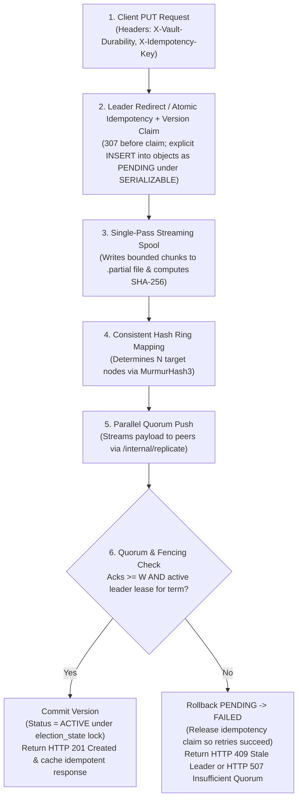

# Vault: Replication Protocol & Quorum Specification

> **Specification of replica placement, quorum equations, consistency levels, and the end-to-end write pipeline.**

---

## 1. Durability Tiers & Quorum Equations

Vault provides configurable durability on a per-object or per-bucket basis via the `X-Vault-Durability` HTTP header.

| Tier | Total Replicas ($N$) | Write Quorum ($W$) | Read Quorum ($R$) | Consistency Guarantee | Target Use Case |
| :--- | :---: | :---: | :---: | :--- | :--- |
| **`CRITICAL`** | 5 | 3 | 2 | **Strict Quorum ($R + W > N$)** | Financial documents, legal contracts, authentication keys |
| **`STANDARD`** | 3 | 2 | 1 | **High Durability ($R + W = N$)** | General application files, images, PDFs, user uploads |
| **`TEMPORARY`**| 1 | 1 | 1 | **Eventual / Single Node** | Ephemeral caches, transcode intermediate files, logs |

### Quorum Math & Early-Quorum Completion
*   **Write Success Condition**: An upload or tombstone returns success **immediately** once:
    $$\text{Acks} \ge W$$
    without blocking for straggler/hung peers beyond the quorum threshold (`ReplicationService.awaitQuorum`). Conversely, if fewer than $W$ eligible non-degraded target nodes exist on the ring (or remaining uncompleted peers cannot mathematically reach $W$), the request fails fast with `507 Insufficient Quorum`.
*   **Topology Sizing Note**: `CRITICAL` ($N=5, W=3$) avoids `DEGRADED` nodes and requires at least 5 eligible nodes for full $N=5$ placement. On a 3-node Compose cluster, `CRITICAL` succeeds only when all 3 nodes are non-degraded (`degradedPlacement: true`, `actualReplicas: 3 < expectedReplicas: 5`). `/api/v1/objects/inspect` reports true `HEALTHY` verification flags per replica rather than synthetic `true`.
*   **Read Repair Trigger**: If a read finds a corrupt local replica (pre-read `FileChannel` SHA-256 mismatch), the node blocks corrupt bytes before HTTP `200`, falls back to verified peer streaming, and schedules deduplicated, bounded (`vault.repair.max-concurrent-repairs`) background read repair.

---

## 2. The 6-Stage Write Pipeline

---

## 3. Tombstone & Deletion Protocol

To preserve auditability while freeing disk space safely:
1. **Soft Delete (Tombstone Creation)**:
   - Deleting a missing or already-tombstoned key is a no-op (no phantom tombstone rows created).
   - Otherwise `ObjectService.delete` claims `version + 1` in `objects` with the object's `DurabilityTier`, replicates `.tombstone` markers (`N, W`), commits `TOMBSTONED`, and then purges prior data versions per version.
   - Subsequent `GET` requests observe the `TOMBSTONED` status and return HTTP 404 (`Not Found`).
2. **Garbage Collection (Leader-Only, Per-Version Replica-First)**:
   - After retention windows (`vault.gc.tombstone-ttl-hours`, `failed-version-ttl-hours`, `superseded-version-ttl-hours`), only the active cluster leader runs `GarbageCollector.sweep()`:
     a. For each eligible version (oldest `< tombstone` versions first, superseded `ACTIVE` versions, and `FAILED` versions), clears `replicas` rows in PostgreSQL before deleting physical `.dat`/`.tombstone` files on storage nodes.
     b. Deletes the `objects` row only once all `replicas` rows for that version are cleared (`remaining == 0`), avoiding foreign-key violations and preventing older versions from resurrecting.
