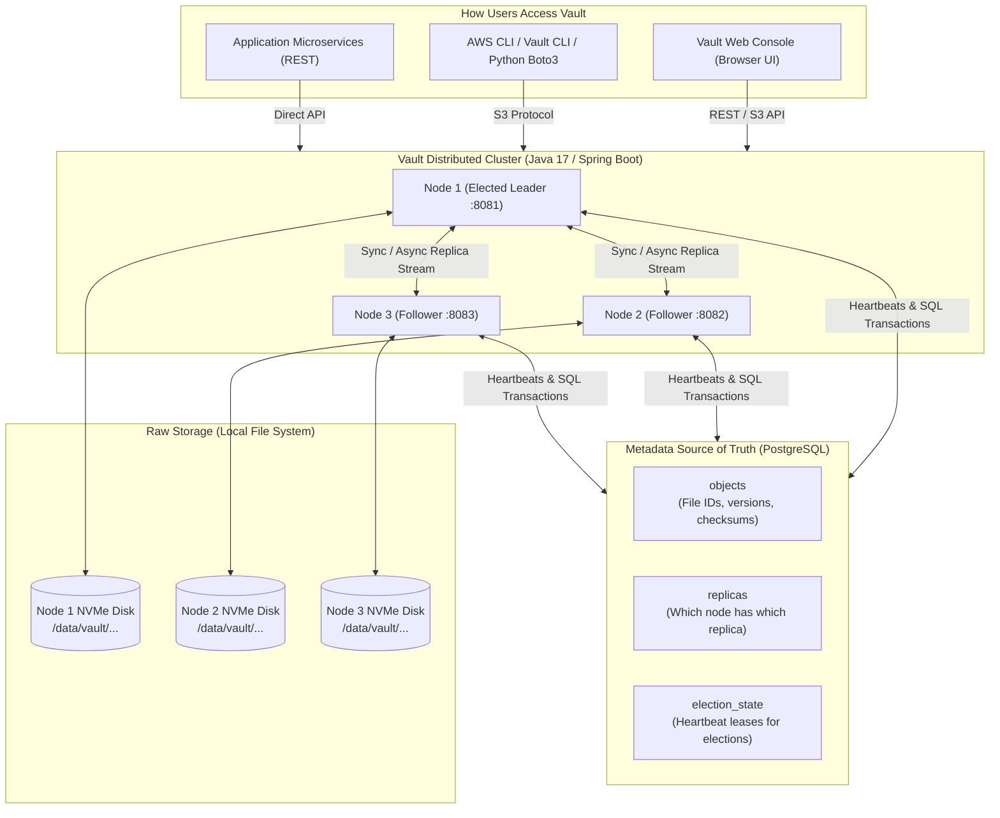
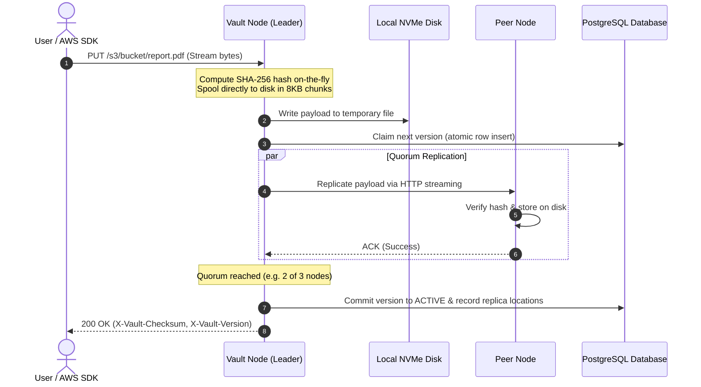
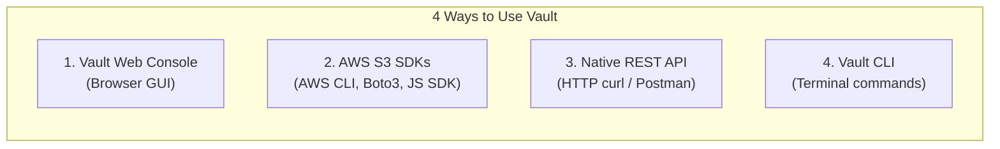

# Vault: Comprehensive System & Architecture Explainer

> **"What is Vault, how does it work, what runs under the hood, and how do users interact with it?"**  
> This guide is your complete reference manual and capstone presentation companion.

---

## 1. What Problem Does Vault Solve?

When modern applications handle files (avatars, PDFs, video uploads, machine learning datasets), developers typically face a frustrating dilemma:

| Storage Approach | The Problem |
| :--- | :--- |
| **Storing in PostgreSQL as `bytea` / BLOBs** | PostgreSQL's write-ahead log (WAL) and memory cache explode. Database backups take hours, queries slow to a crawl, and connection memory spikes ("database bloat"). |
| **Storing in AWS S3 or Google Cloud Storage** | Cloud egress fees are exorbitant. File metadata lives isolated in Amazon's cloud, meaning you cannot write standard SQL `JOIN`s between your files and your database tables (e.g., `SELECT * FROM users JOIN files ON ...`). |
| **Complex Distributed Storage (Ceph, HDFS)** | Massive operational complexity requiring dedicated infrastructure teams, ZooKeeper clusters, and dozens of configuration daemons. |

### The Vault Solution: "Postgres as the Brain, Disks as the Muscle"
Vault is an **open-source, Postgres-native distributed object storage engine** that offers a drop-in S3-compatible API:
1. **The Brain (PostgreSQL)**: Stores lightweight file metadata (version numbers, file sizes, SHA-256 hashes, durability tiers, replica locations, and cluster leader leases).
2. **The Muscle (Local Disks)**: Heavy binary payloads stream in bounded 8 KB chunks to local disk storage across cluster nodes with pre-read SHA-256 verification.

Because metadata is stored in PostgreSQL, developers can link files directly to application tables using standard foreign keys and SQL queries, while avoiding cloud egress fees and database bloat.

---

## 2. High-Level System Architecture



---

## 3. What Happens Under the Hood? (Request Lifecycles)

### A. The Upload Flow (PUT Request)
When a user uploads a file (`PUT /s3/my-bucket/report.pdf` or `PUT /api/v1/objects/report.pdf`):



1. **Streaming Spooling**: The file is **never** loaded into JVM heap memory as a byte array (preventing Out-Of-Memory crashes). It streams through a `DigestInputStream` directly to disk.
2. **Hash Verification**: Vault computes the SHA-256 checksum during the single streaming pass.
3. **Quorum Replication**: Based on the Durability Tier (`STANDARD`, `CRITICAL`, or `TEMPORARY`), the leader streams the replica to peer nodes selected via a 32-bit consistent hash ring.
4. **Metadata Commit**: Once the write quorum is satisfied, the database row in `objects` transitions from `PENDING` to `ACTIVE`.

---

### B. The Download Flow (GET Request) & Self-Healing
When a user downloads a file (`GET /s3/my-bucket/report.pdf` or `/api/v1/objects?key=...`):

```mermaid
sequenceDiagram
    autonumber
    actor User as User / Browser
    participant Node as Vault Node
    participant DB as PostgreSQL Database
    participant Disk as Local Disk
    participant Peer as Peer Node

    User->>Node: GET /s3/bucket/report.pdf
    Node->>DB: Query latest ACTIVE version and SHA-256 hash
    Node->>Disk: Pre-verify FileChannel SHA-256 and size before HTTP 200
    
    alt Data is Healthy
        Node-->>User: 200 OK (Stream verified bytes from pinned FileChannel)
    else Bit-Rot / Missing Local Replica Detected!
        Note over Node: Hash mismatch or missing copy caught BEFORE 200 OK!
        Node->>Peer: Stream replica from peer via Flux<DataBuffer> to temp file
        Peer-->>Node: Peer stream verified against expected SHA-256
        Node-->>User: 200 OK (Serve verified bytes; temp deleted on close)
        Node->>Disk: Stage-verify-atomic-move repair in background
    end
```

*   **Pre-Verified Bounded Streaming**: Full-file SHA-256 and expected length are validated on the local `FileChannel` or staged peer temp file **before** returning HTTP `200`, keeping memory bounded to 8 KB / DataBuffer chunks.
*   **Automatic Read Repair**: If drive degradation corrupts a replica on disk, Vault blocks corrupt bytes before HTTP `200`, falls back transparently to healthy peers (`Flux<DataBuffer>`), and repairs the local file after verifying checksums in staging.

---

### C. Cluster Leadership & Failover (PostgreSQL-Coordinated Leader Lease)
Instead of running a heavy ZooKeeper or etcd cluster:
1. Every node pings PostgreSQL every 1 second (`vault.election.heartbeat-interval-ms`).
2. The current leader renews its lease in the `election_state` table.
3. If the leader crashes or goes offline for more than 5 seconds:
   - Follower election timers fire (randomized between 7s and 12s to prevent split-brain ties).
   - The first follower to acquire the PostgreSQL row lock becomes the new cluster Leader and increments the election `term`.
   - Client requests are seamlessly served by or redirected to the new leader.

---

## 4. How Do Users & Developers Interact with Vault?

Vault offers **4 distinct interfaces**:



### Interface 1: The Interactive Web Console (`website/console.html`)
*   **Target Audience**: End-users, administrators, and developers who prefer a visual dashboard.
*   **What it does**:
    *   **Live Cluster Health**: Visual display of active nodes, who the leader is, and current election term.
    *   **Drag-and-Drop File Manager**: Upload files by dragging them onto the browser; choose Durability Tier (`STANDARD`, `CRITICAL`, `TEMPORARY`).
    *   **File Browser & Viewer**: Preview images, text, and JSON in-browser; download files with a single click.
    *   **Live Code Generator**: Generates copyable AWS CLI, cURL, Python (`boto3`), and Node.js code snippets for any uploaded file.

### Interface 2: Experimental S3-Style Adapter
*   **Target Audience**: Testing S3 path-style REST routes with explicit `X-API-Key` authentication (AWS SigV4 is not implemented).
```bash
curl -X PUT http://localhost:8081/s3/documents/report.pdf \
  -H "X-API-Key: $VAULT_API_KEY" \
  -H "Content-Type: application/octet-stream" \
  --data-binary @report.pdf

curl -H "X-API-Key: $VAULT_API_KEY" http://localhost:8081/s3/documents/report.pdf -o ./downloaded-report.pdf
```

### Interface 3: Native REST API
*   **Target Audience**: Microservices that want fine-grained control over durability and versioning.
```bash
# Upload raw binary payload (slash keys supported via ?key=... or unencoded path; max 128 MiB)
curl -X PUT "http://localhost:8081/api/v1/objects?key=reports/my-file.txt" \
  -H "X-API-Key: $VAULT_API_KEY" \
  -H "X-Vault-Durability: STANDARD" \
  -H "Content-Type: application/octet-stream" \
  --data-binary @my-file.txt

# Download
curl -H "X-API-Key: $VAULT_API_KEY" "http://localhost:8081/api/v1/objects?key=reports/my-file.txt" -o my-file.txt
```

### Interface 4: Vault Python CLI (`scripts/vault_cli.py`)
*   **Target Audience**: Terminal power-users and shell automation scripts.
```bash
python scripts/vault_cli.py put report.pdf --tier STANDARD
python scripts/vault_cli.py list
python scripts/vault_cli.py get report.pdf
python scripts/vault_cli.py cluster
```

---

## 5. Summary of Durability Tiers

| Tier | Replicas ($N$) | Write Quorum ($W$) | Read Quorum ($R$) | Best For |
| :--- | :---: | :---: | :---: | :--- |
| **`CRITICAL`** | 5 | 3 | 2 | Financial records, contracts, user credentials |
| **`STANDARD`** | 3 | 2 | 1 | General application files, images, PDFs (Default) |
| **`TEMPORARY`**| 1 | 1 | 1 | Cache files, temporary video renders, logs |

---

## 6. Capstone Presentation & Viva Quick Reference

**Q: Why not just store files in PostgreSQL directly using `bytea`?**  
*A: Storing binary files in PostgreSQL clogs the Write-Ahead Log (WAL), bloats table memory, destroys vacuum performance, and causes database backups to grow exponentially. Vault separates metadata from payload: PostgreSQL manages relations and ACID state, while local disks stream payloads in bounded chunks with SHA-256 pre-verification.*

**Q: How does Vault handle node failures during a write?**  
*A: Vault uses tunable quorum replication. In `STANDARD` tier ($W=2$), a write only succeeds if at least 2 nodes confirm the data was safely written to disk. If one node fails, the write still succeeds and background anti-entropy or read repair synchronizes the missing copy later.*

**Q: How does Vault detect file corruption (bit-rot)?**  
*A: Every object has its SHA-256 checksum recorded in PostgreSQL upon upload. During reads, the node hashes the file on-the-fly. If the checksum does not match the database record, the node drops the bad file, fetches a verified replica from a peer, serves it to the user, and heals its local disk in the background.*
